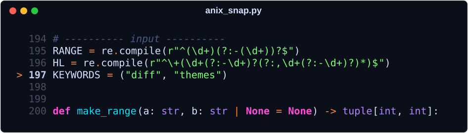

# anix-snap

Beautiful code screenshots right from your terminal. Part of the ANIX family.

🇬🇧 English · 🇷🇺 [Русский](README.ru.md)



## Install

Python 3.9+.

```bash
pip install anix-snap
pip install "anix-snap[png]"   # + PNG via cairosvg
```

PNG also works with [resvg](https://github.com/linebender/resvg) in PATH (easier on Windows than cairo).

## Usage

Just words, in any order. The image is saved next to you and copied to the clipboard.

```bash
asnap api.py                 # whole file
asnap api.py 10-40           # lines 10-40 (api.py:10-40 works too)
asnap api.py 10-40 neon      # theme: peach, noir, neon or your own
asnap api.py +12 +15-17      # mark lines
asnap api.py png             # format: png or svg (picked automatically)
asnap diff                   # current git diff
asnap diff api.py staged     # one file, staged changes
asnap diff HEAD~1            # compare with a commit
cat x.rs | asnap - rust      # stdin, language as a word
asnap themes                 # list themes
asnap                        # cheat sheet
```

Rarely needed: `-o FILE`, `--title TEXT`, `--no-lines`, `--no-copy`, `-w N`, `--scale N`, `--cdn-font`, `--ui ru|en`.

**Rules.** Keywords (`diff`, `themes`, theme names, `png`/`svg`, `staged`) always win over files, so a `themes/` folder in your project does not break anything. For a file with such a name write `./diff`. In `diff` mode git itself decides whether a word is a branch/commit or a file (deleted files too); if it is both, asnap asks you to write `./main`. Lines start at 1, `40-10` is read as `10-40`.

**PNG on Windows:** install [resvg](https://github.com/linebender/resvg) (GitHub Releases or `cargo install resvg`) and add it to PATH. cairosvg needs a separate cairo library there.

By default PNG is made when cairosvg or resvg is available, otherwise SVG. Fira Code is embedded into the SVG (downloaded once, then cached).

## Own themes

Put a `.json` into `%APPDATA%\anix-snap\themes\` (Windows) or `~/.config/anix-snap/themes/` and use it by name: `asnap api.py mytheme`. Missing keys are taken from `peach`. See `themes/example.json`.

Keys: `bg`, `fg`, `kw`, `fn`, `str`, `num`, `comment`, `op`, `builtin`, `add`, `rm`.

## ANIX Code

Copy `extras/anixcode/snap.md` into `.anixcode/commands/` and use `/snap api.py 10-40 neon`.

## Development

```bash
pip install -e ".[dev]"
pytest -q
```

MIT · [an1zy](https://github.com/an1zy)
