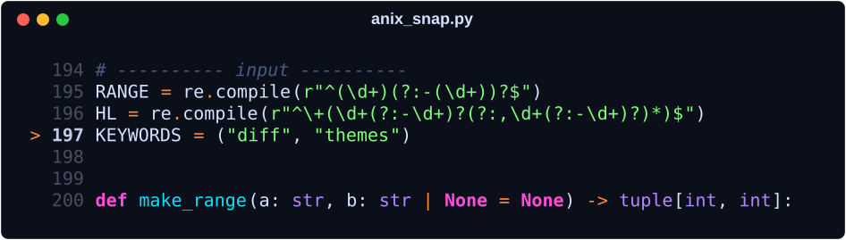

# anix-snap

Красивые скриншоты кода прямо из терминала. Часть семейства ANIX.

🇬🇧 [English](README.md) · 🇷🇺 Русский



## Установка

Python 3.9+.

```bash
pip install anix-snap
pip install "anix-snap[png]"   # + PNG через cairosvg
```

PNG также делается через [resvg](https://github.com/linebender/resvg) в PATH (на Windows это проще, чем cairo).

## Использование

Просто слова, в любом порядке. Картинка сохраняется в текущую папку и сразу лежит в буфере обмена.

```bash
asnap api.py                 # весь файл
asnap api.py 10-40           # строки 10-40 (api.py:10-40 тоже работает)
asnap api.py 10-40 neon      # тема: peach, noir, neon или своя
asnap api.py +12 +15-17      # отметить строки
asnap api.py png             # формат: png или svg (выбирается сам)
asnap diff                   # текущий git diff
asnap diff api.py staged     # один файл, staged-изменения
asnap diff HEAD~1            # сравнить с коммитом
cat x.rs | asnap - rust      # stdin, язык словом
asnap themes                 # список тем
asnap                        # шпаргалка
```

Редко нужно: `-o ФАЙЛ`, `--title ТЕКСТ`, `--no-lines`, `--no-copy`, `-w N`, `--scale N`, `--cdn-font`, `--ui ru|en`.

**Правила.** Ключевые слова (`diff`, `themes`, названия тем, `png`/`svg`, `staged`) всегда главнее файлов, так что папка `themes/` в проекте ничего не ломает. Для файла с таким именем пиши `./diff`. В режиме `diff` сам git решает, ветка/коммит это или файл (удалённые тоже); если и то и другое, asnap попросит написать `./main`. Строки считаются с 1, `40-10` понимается как `10-40`.

**PNG на Windows:** поставь [resvg](https://github.com/linebender/resvg) (GitHub Releases или `cargo install resvg`) и добавь в PATH. cairosvg там требует отдельную библиотеку cairo.

По умолчанию делается PNG, если есть cairosvg или resvg, иначе SVG. Шрифт Fira Code вшивается в SVG (скачивается один раз, потом из кеша).

## Свои темы

Положи `.json` в `%APPDATA%\anix-snap\themes\` (Windows) или `~/.config/anix-snap/themes/` и вызывай по имени: `asnap api.py mytheme`. Недостающие ключи берутся из `peach`. Пример: `themes/example.json`.

Ключи: `bg`, `fg`, `kw`, `fn`, `str`, `num`, `comment`, `op`, `builtin`, `add`, `rm`.

## ANIX Code

Скопируй `extras/anixcode/snap.md` в `.anixcode/commands/` и вызывай `/snap api.py 10-40 neon`.

## Разработка

```bash
pip install -e ".[dev]"
pytest -q
```

MIT · [an1zy](https://github.com/an1zy)
